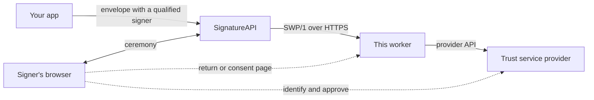
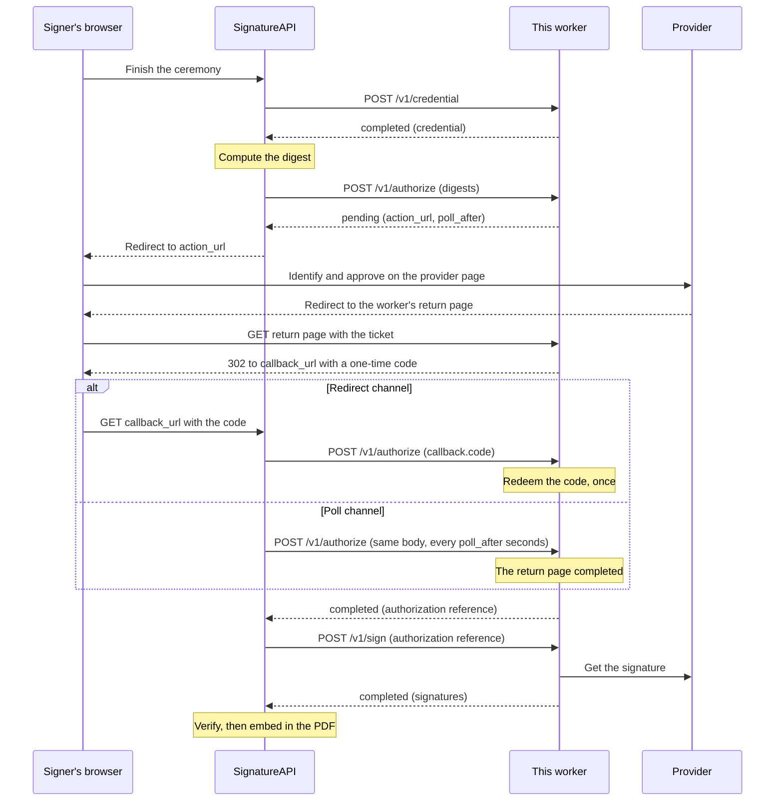

# SignatureAPI signing worker starter (Node.js)

A ready-to-deploy [signing worker](https://signatureapi.com/docs/qualified-signatures/signing-workers) for [SignatureAPI qualified signatures](https://signatureapi.com/docs/qualified-signatures), written in Node.js and TypeScript. It receives [Signing Worker Protocol](https://signatureapi.com/docs/qualified-signatures/signing-worker-protocol) (SWP/1) calls from SignatureAPI and turns them into calls to your trust service provider's API. The protocol layer (request authentication, idempotency, the single-use authorization, browser hand-offs) is written once. Each provider is a pluggable strategy in its own folder, and `PROVIDER` picks one.
- [How it fits](#how-it-fits)
- [The signing flow](#the-signing-flow)
- [Quick start](#quick-start)
- [Providers](#providers)
- [Connect to SignatureAPI](#connect-to-signatureapi)
- [Configuration](#configuration)
- [Deploy](#deploy)
- [Security model](#security-model)
- [Conformance testing](#conformance-testing)
- [Project layout](#project-layout)

## How it fits

A qualified electronic signature (QES) is made with a certificate and a key that a qualified trust service provider (QTSP) holds for the signer. SignatureAPI is not a QTSP. You choose the provider and keep your contract with it. The signing worker is the small HTTPS service between the two:



- **SignatureAPI** runs the envelope and the ceremony, computes the document digest, verifies the returned signature and embeds it in the PDF.
- **The worker** gets that digest signed through your provider. It never sees the documents, only one digest per signature.
- **The provider** identifies the signer, records their approval and signs with their key.

You run the worker, so the provider credentials and the provider contract stay with you. SignatureAPI never holds them. Every provider has its own API and signer experience; the worker translates them into one protocol. Read [Signing workers](https://signatureapi.com/docs/qualified-signatures/signing-workers) for the full picture and [Choose your provider's model](https://signatureapi.com/docs/qualified-signatures/worker-models) to see which shape your provider has.

## The signing flow

For each signature, SignatureAPI calls three operations in order: [`credential`](https://signatureapi.com/docs/qualified-signatures/signing-worker-protocol/credential) (which certificate signs, in which format), [`authorize`](https://signatureapi.com/docs/qualified-signatures/signing-worker-protocol/authorize) (the signer approves this exact digest) and [`sign`](https://signatureapi.com/docs/qualified-signatures/signing-worker-protocol/sign) (the signature). When the signer has something to do at the provider, `credential` or `authorize` answers `pending`. See [Pending steps](https://signatureapi.com/docs/qualified-signatures/signing-worker-protocol/pending-steps).

Both providers in this repo wait for the signer once, during `authorize`:



Whichever channel arrives first resolves the step. The other one then has no effect.

| Step                    | What happens                                                                         | Where                                                      |
| ----------------------- | ------------------------------------------------------------------------------------ | ---------------------------------------------------------- |
| Every `POST`            | Protocol header, JWT, connection token, `Content-Digest`, `Idempotency-Key`          | `src/protocol/authenticate.ts`, `jwt.ts`, `idempotency.ts` |
| Routing                 | Request validation, the provider context, provider outcome to wire JSON              | `src/protocol/operations.ts`, `envelope.ts`                |
| `credential`            | The provider returns its credential (`raw` with a chain, or `cms`)                   | `src/providers/<name>/index.ts`                            |
| `authorize`, first call | The provider starts a hand-off: a ticketed URL on this worker, answered as `pending` | `ctx.handoff.begin` in `src/protocol/handoff.ts`           |
| Return or consent page  | The page retires the ticket, mints one code and redirects to `callback_url`          | `page.complete` in `src/protocol/handoff.ts`               |
| `authorize`, resumed    | The provider redeems the code (or sees the page completed) and grants                | `ctx.grant` in `src/protocol/authorization.ts`             |
| `sign`                  | The provider spends the authorization once and returns the signatures                | `ctx.spend` in `src/protocol/authorization.ts`             |

With `byo`, the "provider page" is the worker's own `/consent` page and the worker signs locally. With `eideasy`, it is eID Easy's hosted signing page, which sends the browser back to `/eideasy/return`.

## Quick start

Requires Node.js 24 or newer. This runs the `byo` provider with a throwaway P-256 key and a self-signed certificate:

```bash
npm ci
mkdir -p certs
openssl ecparam -name prime256v1 -genkey -noout | openssl pkcs8 -topk8 -nocrypt -out certs/key.pem
openssl req -new -x509 -key certs/key.pem -out certs/chain.pem -days 30 -subj "/CN=Test signer"
cp .env.example .env
npm run dev
```

In another terminal:

```bash
curl http://localhost:8080/v1/health
```

```json
{ "status": "ok", "rail": "byo", "connection_tokens": ["swpct_replace_me"] }
```

`npm run dev` reads `.env` and restarts on changes. `npm start` reads the real environment only. `certs/` and `.env` are in `.gitignore`.

Checks: `npm run lint`, `npm run typecheck`, `npm test`.

## Providers

| Provider  | What it does                                                                                                                                    | Format | Signer step                                       |
| --------- | ----------------------------------------------------------------------------------------------------------------------------------------------- | ------ | ------------------------------------------------- |
| `byo`     | Signs with a P-256 key and certificate you supply, after the signer approves on a consent page this worker hosts                                | `raw`  | Consent page at `/consent`                        |
| `eideasy` | Sends the signer to [eID Easy](https://eideasy.com) (Smart-ID, Mobile-ID, national eID cards and more) and returns the CMS that eID Easy builds | `cms`  | eID Easy's hosted page, back to `/eideasy/return` |

Set `PROVIDER` to the one you run. Only that provider's factory runs, so the other providers' variables can stay unset. See [Signature formats](https://signatureapi.com/docs/qualified-signatures/signing-worker-protocol/signature-formats) for `raw` and `cms`.

### `byo`: bring your own key

The smallest complete provider: a `raw` credential with your chain, one consent page, and an ECDSA P-256 signature over the SHA-256 digest. Copy it to integrate a provider that signs a digest with a key it holds: an HSM, a cloud KMS, or a provider's sign-hash API.

`byo` is not a qualified signature. A private key in an environment variable or a file is not a qualified signature creation device. Use it to test, and as a template.

### `eideasy`: eID Easy

- **`cms` credential.** eID Easy builds the CMS and the signer certificate is known only after signing, so `credential` returns no certificate and the chain arrives with `sign`. See [Requirements on a CMS signature](https://signatureapi.com/docs/qualified-signatures/signing-worker-protocol/signature-formats#requirements-on-a-cms-signature).
- **One digest per request.** `authorize` uploads one SHA-256 digest to eID Easy and refuses a request with more than one (`digest_rejected`).
- **Poll-safe.** The upload runs once per signing session (`ctx.state.once`), so a poll never uploads the digest again.
- **No iframe.** eID Easy's hosted page doesn't load inside an iframe. If you [embed the ceremony in your app](https://signatureapi.com/docs/api/guides/how-to/embed-web), the redirect to eID Easy happens inside that iframe, so signers who sign through eID Easy need a ceremony in a top-level window.
- **Sandbox by default.** `EIDEASY_BASE_URL` defaults to `https://test.eideasy.com`. Use `https://id.eideasy.com` with production credentials.

The provider's code is tested against a fake eID Easy server (`test/eideasy.test.ts`). The eID Easy behavior it relies on was verified against eID Easy's sandbox in a separate prototype: the return URL comes back verbatim, the CMS `messageDigest` equals the uploaded digest, and the issuer certificates arrive in `pades_dss_data`.

### Remove a provider

- **`eideasy`.** Delete `src/providers/eideasy/`, its line in `src/providers/index.ts`, and `test/eideasy.test.ts`.
- **`byo`.** The protocol tests and the CI conformance job run against `byo`. Keep it as the test fixture, even if you never deploy it.

### Write your own provider

1. Create `src/providers/<name>/index.ts` with a factory that reads its own environment variables and returns a `Provider`.
2. Register the factory in `src/providers/index.ts`.
3. Set `PROVIDER=<name>`.

The interface, from `src/providers/types.ts`:

```ts
export interface Provider {
  /** Reported by `GET /v1/health` as `rail`. */
  readonly name: string;
  /** What `sign` answers with. The platform asks `sign` for this format. */
  readonly format: SignatureFormat;
  credential(ctx: Context<CredentialRequest>): Promise<CredentialOutcome>;
  authorize(ctx: AuthorizeContext): Promise<AuthorizeOutcome>;
  sign(ctx: SignContext): Promise<SignOutcome>;
  /** Browser pages, by path. A path must not start with `/v1/`. */
  readonly pages?: Readonly<Record<`/${string}`, PageHandler>>;
}
```

A skeleton for a provider with a hosted page that sends the browser back to the worker:

```ts
import type { Provider } from "../types.ts";
import { credential, failed, is, pending, signed } from "../types.ts";
import { createMyClient } from "./client.ts"; // your provider's API client

const PURPOSE = "my-return";
const RETURN_PATH = "/my-provider/return";

export function myProviderFromEnv(env: NodeJS.ProcessEnv): Provider {
  const apiKey = env.MY_PROVIDER_API_KEY;
  if (!apiKey) {
    throw new Error("my-provider: MY_PROVIDER_API_KEY is required");
  }
  const client = createMyClient(apiKey);
  return {
    name: "my-provider",
    format: "cms",

    async credential() {
      return credential.cms({ id: "my-provider" });
    },

    async authorize(ctx) {
      const { callbackCode } = ctx.request;
      if (callbackCode !== undefined) {
        return (await ctx.handoff.redeem(callbackCode, PURPOSE))
          ? ctx.grant({ data: { providerDocumentId: "…" } })
          : failed("access_denied", "unknown or already used link");
      }
      if (await ctx.handoff.completed(PURPOSE)) {
        return ctx.grant({ data: { providerDocumentId: "…" } });
      }
      const ticket = await ctx.handoff.begin({ purpose: PURPOSE, path: RETURN_PATH, ttlMs: 10 * 60 * 1000 });
      // Upload the digest with ticket.url as the return URL. Wrap it in ctx.state.once so a poll never repeats it.
      return pending({ actionUrl: "https://provider.example/sign/…", pollAfter: 3, expiresAt: ticket.expiresAt });
    },

    async sign(ctx) {
      const authorization = await ctx.spend(is.object({ providerDocumentId: is.string }));
      if (!authorization.ok) {
        return authorization.failure;
      }
      // One CMS per digest, and the PEM chain, leaf first.
      const file = await client.download(authorization.data.providerDocumentId);
      return signed.cms(file.cmsList, file.certificates);
    },

    pages: {
      [RETURN_PATH]: async (request, page) => {
        const ticket = await page.ticket(request, PURPOSE);
        return ticket instanceof Response ? ticket : page.complete(ticket);
      },
    },
  };
}
```

Answer with the builders from `src/providers/types.ts`:

| Builder                                                       | When                                                                                                                 |
| ------------------------------------------------------------- | -------------------------------------------------------------------------------------------------------------------- |
| `credential.raw({ id, certificates, keyAlgoOids })`           | You know the signer's certificate before signing                                                                     |
| `credential.cms({ id, maxSignatureSize? })`                   | Your provider builds the CMS and the certificate arrives with the signature                                          |
| `pending({ actionUrl, pollAfter, expiresAt })`                | The signer has something to do. `actionUrl` sends the browser somewhere, `pollAfter` asks SignatureAPI to call again |
| `ctx.grant({ data })`                                         | From `authorize`, once the signer approved. `data` is yours and comes back from `ctx.spend(guard)` in `sign`         |
| `signed.raw(signatures)`, `signed.cms(cmsList, certificates)` | From `sign`, one signature per digest                                                                                |
| `failed(code, why)`                                           | A final refusal                                                                                                      |
| `failed.retryable(code, why)`                                 | From `credential` or `authorize` only, when nothing was started                                                      |

The context also gives you:
- **`ctx.request`**: the validated request, camelCase (`credentialId`, `digests[].bytes`, `callbackCode`, …).
- **`ctx.state.get / put / once(key, guard, create)`**: per-session state. A guard such as `is.object({ docId: is.string })` validates every read, and a row that fails it reads as absent. Use `once` for anything that must happen once per session, because a poll calls the same operation again.
- **`ctx.handoff.begin({ purpose, path, ttlMs })`**: a ticketed URL on this worker for the signer's browser. `ctx.handoff.redeem(code, purpose)` spends the code SignatureAPI resumes with. `ctx.handoff.completed(purpose)` tells a poll that the page finished.
- **`page.ticket(request, purpose)`** in a page handler: the open ticket, or a ready 404/410 page. `page.complete(ticket)` retires it, mints its one code and redirects to SignatureAPI.

Throwing from `credential` or `authorize` answers `503`, and SignatureAPI retries. Throwing from `sign` answers a stored, non-retryable `internal_error`: once your provider was asked to sign, nobody can prove it did not. The types don't let `sign` return `pending` or a retryable failure.

## Connect to SignatureAPI

Qualified signatures are in private beta; [request access](https://signatureapi.com/docs/qualified-signatures) first. Then:
1. Deploy the worker at a public HTTPS URL on port 443 (see [Deploy](#deploy)) and set `PUBLIC_URL` to it.
2. In the Dashboard, go to **Settings › Developers › Qualified Signatures** and select **Connect Test Worker** or **Connect Live Worker**.
3. Copy the **Connection token** the dialog shows into `SIGNATUREAPI_CONNECTION_TOKENS`, and restart the worker.
4. Enter the worker URL and select **Check and Connect**.

SignatureAPI runs the [connection checks](https://signatureapi.com/docs/qualified-signatures/connection-checks) before saving: the URL is HTTPS on port 443 and public, `GET /v1/health` answers `ok`, the health response lists your connection token, and the worker refuses a token for another audience (`401`) and a valid request without an `Idempotency-Key` (`400`). Nothing is saved unless every check passes. Full steps: [Connect a signing worker](https://signatureapi.com/docs/qualified-signatures/connect-signing-worker).

**Test mode and live mode.** Each mode has its own connection and its own connection token, so a test token never authorizes live signing. A common setup points test at a worker that uses the provider's test environment (for `eideasy`, the sandbox) and live at one that uses production. List several tokens, comma-separated, if one worker serves several accounts or both modes. Before live mode, work through [Build and test a signing worker](https://signatureapi.com/docs/qualified-signatures/build-signing-worker) and [Go live](https://signatureapi.com/docs/qualified-signatures/go-live).

## Configuration

| Variable                                              | Required  | Meaning                                                                                                                                        |
| ----------------------------------------------------- | --------- | ---------------------------------------------------------------------------------------------------------------------------------------------- |
| `PROVIDER`                                            | yes       | `byo` or `eideasy`.                                                                                                                            |
| `PUBLIC_URL`                                          | yes       | The URL SignatureAPI calls the worker at, exactly as entered in the Dashboard. It is the only accepted JWT `aud`. A trailing slash is removed. |
| `SIGNATUREAPI_CONNECTION_TOKENS`                      | yes       | Comma-separated `swpct_…` tokens of the accounts this worker serves. The worker refuses to start without one.                                  |
| `PORT`                                                | no        | Listening port. Default `8080`.                                                                                                                |
| `DATABASE_PATH`                                       | no        | SQLite file for worker state. Default `./data/worker.sqlite`; the Docker image uses `/data/worker.sqlite`.                                     |
| `PLATFORM_ISSUER`                                     | no        | Expected JWT `iss`. Default `https://api.signatureapi.com`.                                                                                    |
| `PLATFORM_JWKS_URL`                                   | no        | SignatureAPI's public keys. Default `https://api.signatureapi.com/v1/signing-protocol/jwks`.                                                   |
| `BYO_CERTIFICATES_PEM` or `BYO_CERTIFICATES_PEM_FILE` | `byo`     | Certificate chain, leaf first, as PEM text or a file path.                                                                                     |
| `BYO_PRIVATE_KEY_PEM` or `BYO_PRIVATE_KEY_PEM_FILE`   | `byo`     | The leaf's P-256 private key (PKCS#8 PEM). The worker checks that it matches the leaf.                                                         |
| `EIDEASY_CLIENT_ID`, `EIDEASY_SECRET`                 | `eideasy` | API credentials from eID Easy.                                                                                                                 |
| `EIDEASY_BASE_URL`                                    | no        | Default `https://test.eideasy.com` (the sandbox). Production: `https://id.eideasy.com`.                                                        |

Change `PLATFORM_ISSUER` and `PLATFORM_JWKS_URL` only for local testing, such as the [conformance tester](#conformance-testing).

## Deploy

### Docker

The `Dockerfile` runs the TypeScript sources directly on Node 24 (no build step), runs as the `node` user and keeps state on the `/data` volume:

```bash
docker build -t swp-worker .
docker run -p 8080:8080 -v swp-data:/data -v "$PWD/certs:/certs:ro" --env-file .env \
  -e BYO_CERTIFICATES_PEM_FILE=/certs/chain.pem -e BYO_PRIVATE_KEY_PEM_FILE=/certs/key.pem swp-worker
```

Docker's `--env-file` takes one `NAME=value` per line, so pass PEM material as files (as above) or as `-e` values. The image has a `HEALTHCHECK` on `/v1/health`.

### Public HTTPS

SignatureAPI calls only `https` URLs on port 443 that resolve to public addresses, with a certificate from a public certificate authority, and never follows redirects. Put TLS in front of the container (your platform's load balancer or a reverse proxy) and set `PUBLIC_URL` to the HTTPS address, exactly as you enter it in the Dashboard. A mismatch fails every request with `unexpected aud`. See [Requirements at a glance](https://signatureapi.com/docs/qualified-signatures/signing-worker-protocol#requirements-at-a-glance).

### One instance, one SQLite file

The worker keeps its state (seen `jti`s, idempotency records, authorizations, tickets, codes, provider state) in one SQLite file, and runs as one instance per volume. Signing traffic is light, a few requests per signature, so one instance goes a long way. Any platform that runs a container with a persistent volume works.

To run several instances, every instance must see the same state, and two instances must not execute requests for one signing session at the same time:
1. Move `src/protocol/store.ts` to a shared database with atomic check-and-set, such as Postgres.
2. Route requests by session, or replace the in-memory reservation in `src/protocol/idempotency.ts` with a database lock.

## Security model

The protocol layer enforces these for every provider, before the provider runs:
- **Request authentication.** Every `POST` carries an ES256 JWT that SignatureAPI signs for that one request. The worker verifies it against SignatureAPI's key set (cached, refetched for a rotated key) and checks `iss`, `aud`, `exp`, `iat`, the operation, the session and the body hash. No shared secrets. See [Authentication](https://signatureapi.com/docs/qualified-signatures/signing-worker-protocol/authentication#verify-a-request).
- **Connection tokens.** The worker accepts only the accounts it lists and refuses to start without a list. Without it, any account that learns your URL could send signing requests to your provider. See [Connection tokens](https://signatureapi.com/docs/qualified-signatures/signing-worker-protocol/authentication#connection-tokens).
- **Replay protection.** Each `jti` is accepted once, and recorded only after every check passed, so a refused request can't use up a legitimate retry. See [Replays](https://signatureapi.com/docs/qualified-signatures/signing-worker-protocol/authentication#replays).
- **`Content-Digest`.** The header must match the SHA-256 of the raw body.
- **Idempotency.** A completed or final outcome is stored and replayed byte for byte for the same `Idempotency-Key`. The same key with another body, or while it is executing, answers `409`. A retried `sign` gets the stored signatures, so nothing signs twice. See [Idempotency](https://signatureapi.com/docs/qualified-signatures/signing-worker-protocol/errors#idempotency).
- **Single-use authorization.** `ctx.grant` binds the authorization to the credential and the exact digest set. The first `sign` that presents it spends it; another credential or digest set is refused.
- **Single-use codes.** Browser pages carry an unguessable ticket. Completing a page retires the ticket and mints exactly one code, so a double click or the back button can't produce a second one. A GET only shows a page; the consent action sits behind a POST, because link scanners follow GETs.
- **Validate on read.** Everything read back from storage passes a guard. A stale or corrupt row reads as absent and degrades to a protocol failure, never a crash.
- **No personal data in logs.** Request bodies carry the signer's name and email. The worker never logs bodies; keep it that way in your provider.
- **Framing allowed on purpose.** Pages send restrictive headers but no `frame-ancestors`, because ceremonies can run inside an iframe.

Your part:
- **Keep `DATABASE_PATH` private.** It holds the authorizations and codes of the sessions in flight. Rows expire after a day and are swept every ten minutes.
- **Use qualified certificates in live mode.** SignatureAPI checks the signature and the chain, not that the certificate is qualified. That's the worker owner's responsibility.

## Conformance testing

The black-box SWP/1 tester lives in the workspace repo [`signatureapi/swp-workers-examples`](https://github.com/signatureapi/swp-workers-examples), under `shared/conformance`. It plays SignatureAPI (serving its own key set) and the signer's browser, and runs 16 cases:
- **Happy paths.** Health lists the token; `credential` completes; the redirect channel (page, code, resume, a `sign` that verifies, a byte-identical replay, a single-use authorization); the poll channel.
- **Security negatives.** Idempotency conflict (`409`); expired token, wrong `aud`, wrong `iss`, tampered body, unlisted connection token, replayed `jti`, a token for another operation or session (`401`); tampered `Content-Digest`, missing protocol header, missing `Idempotency-Key` (`400`).

Run it against a local `byo` worker, with both repos cloned side by side:

```bash
PROVIDER=byo PUBLIC_URL=http://127.0.0.1:8080 PLATFORM_JWKS_URL=http://127.0.0.1:4455/jwks \
  SIGNATUREAPI_CONNECTION_TOKENS=swpct_local BYO_CERTIFICATES_PEM_FILE=certs/chain.pem \
  BYO_PRIVATE_KEY_PEM_FILE=certs/key.pem npm start &
node ../swp-workers-examples/shared/conformance/src/cli.ts --worker http://127.0.0.1:8080 --connection-token swpct_local
```

CI (`.github/workflows/ci.yml`) runs three jobs: `check` (lint, typecheck, unit tests), `docker` (builds the image and waits for its health check), and `conformance` (starts a `byo` worker with a throwaway certificate and runs the tester). The workspace repo is private for now, so the `conformance` job needs a repository secret `SWP_WORKSPACE_TOKEN` with read access to `signatureapi/swp-workers-examples`. Without the secret, the job skips with a warning: a green run then does not mean conformance ran.

## Project layout

```
src/
  server.ts            entry point: config, SQLite, HTTP listener, sweeper
  config.ts            environment
  protocol/            SWP/1, the same for every provider
    authenticate.ts    JWT, connection token, Content-Digest, in the protocol's order
    jwt.ts             ES256 verification and the platform key set
    envelope.ts        request validation, snake_case to camelCase
    idempotency.ts     Idempotency-Key: replay, 409, in-flight reservation
    operations.ts      routes, provider context, provider outcome to wire
    authorization.ts   the single-use authorization (grant, spend)
    handoff.ts         tickets, codes, browser pages
    store.ts           node:sqlite storage
  providers/
    types.ts           the provider interface and outcome builders
    index.ts           PROVIDER to provider
    byo/               bring your own key (raw)
    eideasy/           eID Easy (cms)
test/                  protocol, byo and eideasy tests (Vitest)
Dockerfile             production image
.env.example           every variable, commented
```

## License

[MIT](LICENSE)
